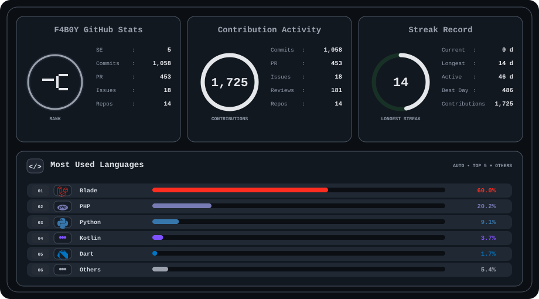
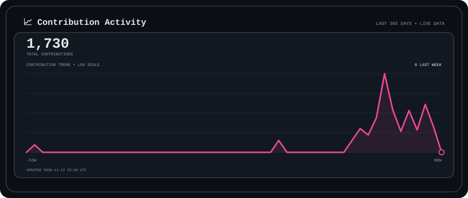

# F4B0Y — Software Developer

**Software Developer · Web Engineer · AI Builder**

Building useful digital products through engineering, experimentation, and continuous improvement.

 

---

## 01 / ABOUT

I'm a software developer interested in building practical, scalable, and well-engineered digital products.

My interests span across web development, mobile applications, AI-powered systems, and software architecture.

- **Web Engineering** — Developing modern web applications and backend systems.
- **Mobile Development** — Building cross-platform applications and API integrations.
- **AI & Automation** — Exploring intelligent agents, automation, and AI workflows.
- **Software Engineering** — Learning clean architecture, system design, security, and database optimization.
- **Research Interests** — Exploring the possibilities of AI and quantum computing.

> I believe good software is not just about making things work. It's about making them reliable, maintainable, and useful.

---

## 02 / TECHNOLOGY

**Languages**

**Backend & Frameworks**

**Database & Infrastructure**

**Development Tools**

---

## 03 / SELECTED PROJECTS

### 01. Universal Task AI

**AI · Automation · System Engineering**

A modular AI assistant concept designed to coordinate tasks, automate workflows, and connect intelligent agents with practical development environments.

- Multi-agent orchestration
- Task planning and execution
- Workflow automation
- Security and execution pipelines

[Explore Repository →](https://github.com/Fbi-Boy/universal-task-ai)

---

### 02. Madura Mart

**Laravel · MySQL · E-commerce Management**

A retail management system with role-based access and operational workflows.

- Multi-role user management
- Point of Sale and cashier operations
- Warehouse and inventory management
- Purchasing and delivery workflows
- Administrative reporting

[Explore Repository →](https://github.com/Fbi-Boy/madura-mart)

---

### 03. Bank Sampah Sahabat Ibu

**Laravel · Flutter · API Development**

A web and mobile application concept for managing waste bank operations and community services.

- Waste category and pricing management
- Citizen management
- Waste deposit verification
- Balance and financial management
- Mobile application integration

[Explore Laravel Repository →](https://github.com/erxdsgn/bank-sampah-sahabat-ibu)

---

### 04. PT Putra Prananta

**Laravel · Tailwind CSS · Alpine.js**

A modern company profile website focused on clean frontend implementation and responsive presentation.

[Explore Repository →](https://github.com/Fbi-Boy/pt-putra-prananta-website)

---

## 04 / GITHUB ANALYTICS

---

## 05 / CONTRIBUTION ACTIVITY

---

## 06 / CURRENT INTERESTS

| Area | Focus |
|---|---|
| Backend Engineering | Laravel, API design, database optimization |
| Frontend Engineering | Modern UI, responsive design, interactions |
| AI Engineering | AI agents, automation, orchestration |
| System Design | Architecture, scalability, security |
| Computer Science | Algorithms, data structures, computing fundamentals |

---

## 07 / DEVELOPER PHILOSOPHY

### Build with purpose.  
### Engineer with discipline.  
### Improve without stopping.

 

  

F4B0Y · Software Developer

